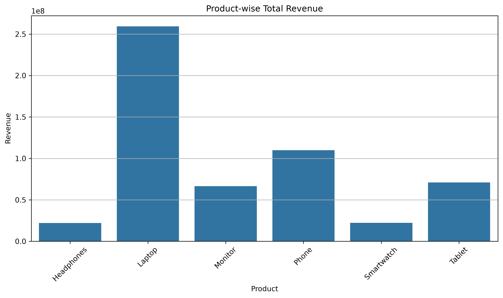
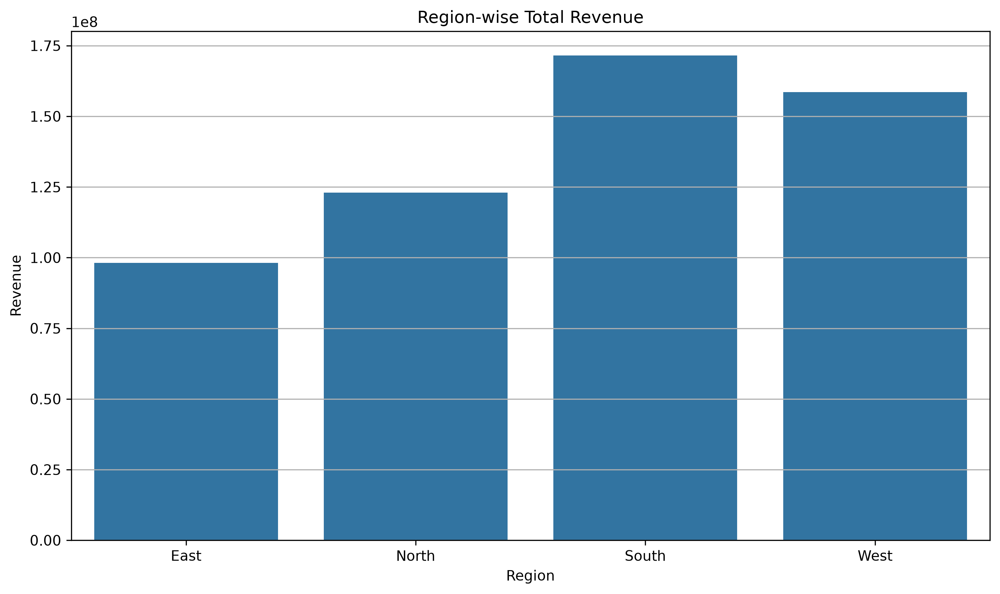
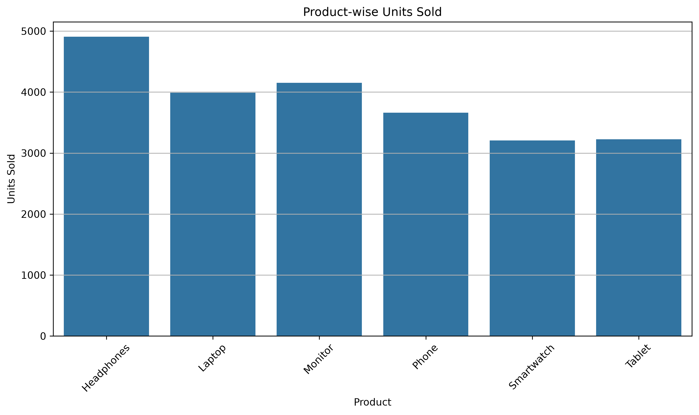
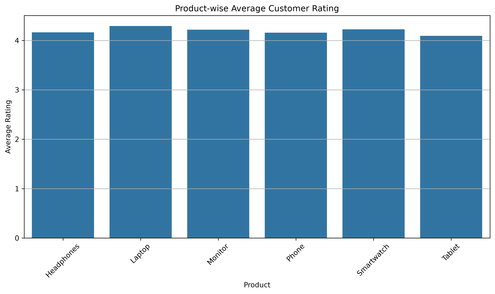
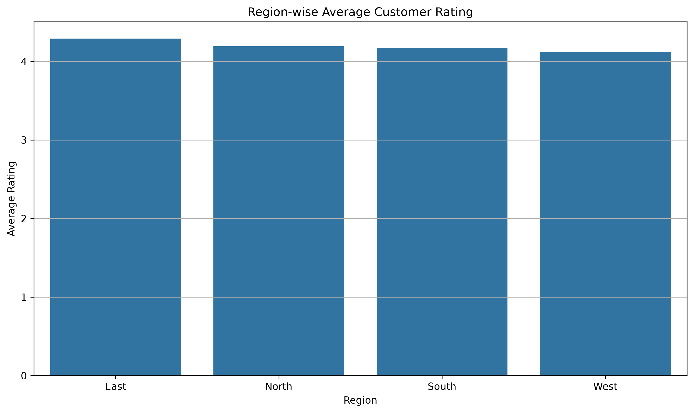
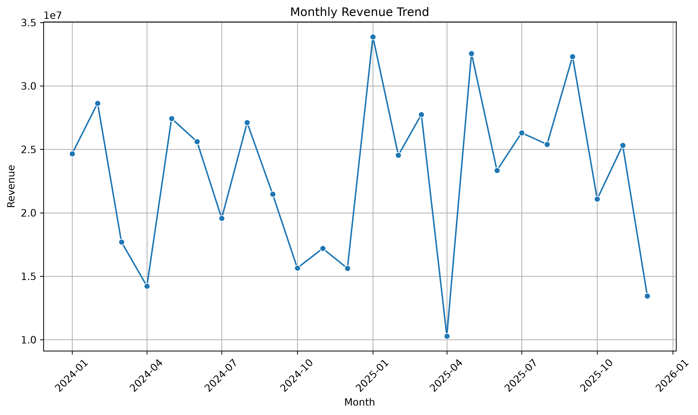
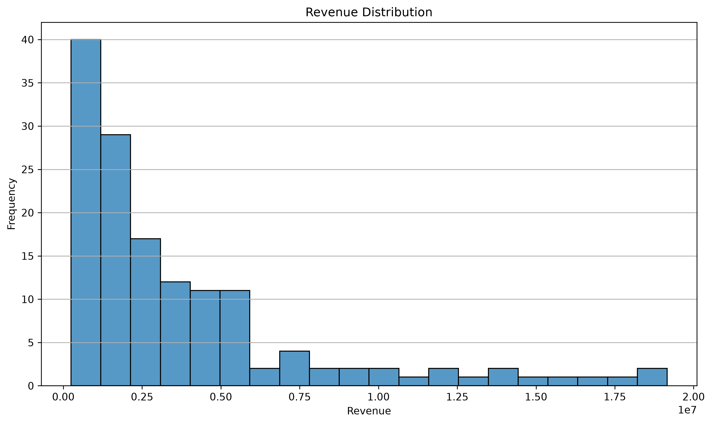
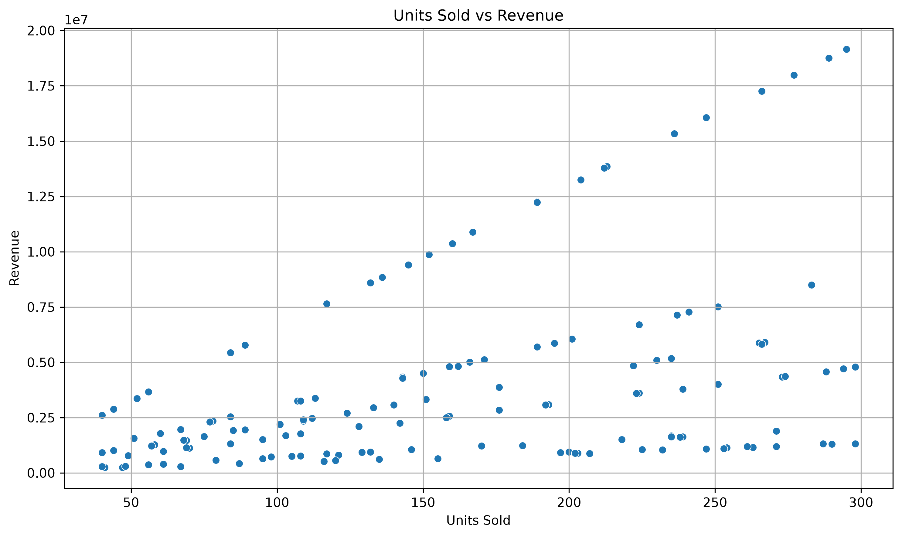
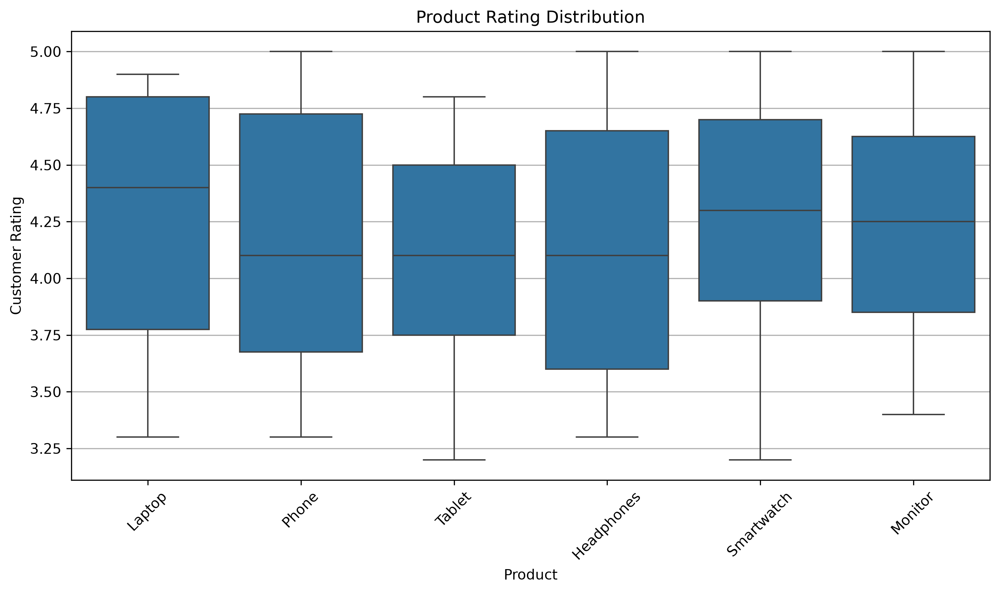
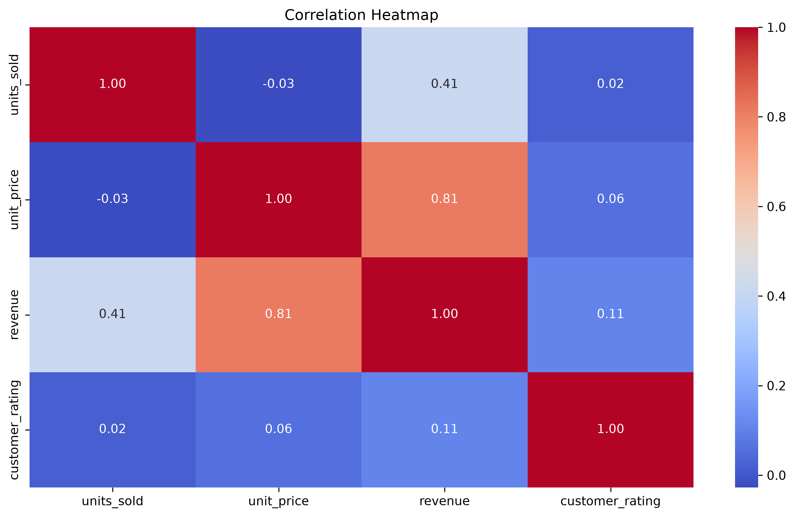

# Sales Data Analysis Using Python

# Project Overview
This project analyzes sales data using Python to identify product performance, regional revenue trends, customer ratings, and relationships between units sold and revenue.

# Objectives
- Analyze total revenue by product and region.
- Identify products with the highest unit sales.
- Compare average customer ratings.
- Explore monthly revenue trends.
- Visualize revenue distribution and numerical correlations.
- Generate business insights from the data.

# Tools & Technologies
- Python
- Pandas
- Matplotlib
- Seaborn
- CSV dataset

# Project Structure
SALES_PROJECT/
├── DATA/
│   ├── 01_load_data.py
│   ├── 02_data_cleaning.py
│   ├── 03_data_analysis.py
│   ├── 03_sales_analysis.py
│   └── 04_visualization.py
├── CHARTS/
├── cleaned_sales.csv
├── matplotlib_sales_practice.csv
└── README.md

# Visualizations

# 1. Product-wise Total Revenue


# 2. Region-wise Total Revenue


# 3. Product-wise Units Sold


# 4. Product-wise Average Customer Rating


# 5. Region-wise Average Customer Rating


# 6. Monthly Revenue Trend


# 7. Revenue Distribution


# 8. Units Sold vs Revenue


# 9. Product Rating Distribution


# 10. Numerical Correlation Heatmap


# Key Business Insights
- Compare product revenue to identify strong and weak revenue contributors.
- Compare regional revenue to understand differences in regional performance.
- Use unit sales and customer ratings to evaluate product performance.
- Review monthly revenue to identify changes over time.
- Use scatter plots and correlation analysis to explore relationships between numerical variables.

*Note: Specific business conclusions should be based on the results generated by the project scripts.*

# How to Run
Run the scripts from the `SALES_PROJECT` root directory.

```bash
python DATA/01_load_data.py
python DATA/02_data_cleaning.py
python DATA/03_sales_analysis.py
python DATA/04_visualization.py
```

The visualization script saves ten PNG charts in the `CHARTS/` folder.

# Author
Pratik Jadhav
